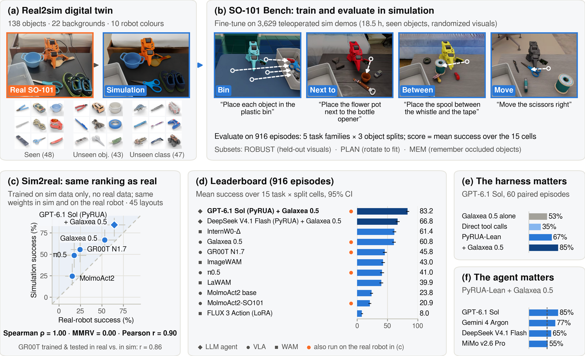

# SO-101 Bench: Accessible Spatial Manipulation



A simulated benchmark for language-conditioned spatial manipulation with the low-cost
[SO-101](https://github.com/TheRobotStudio/SO-ARM100) arm, built on an Isaac Lab digital twin of a real
SO-101 setup. Four tasks (bin, next to, between, directional move), 138 objects in three generalization
splits, and policy rankings that hold on the real robot.

[Project page](https://so101-bench.github.io) ·
[Paper](https://so101-bench.github.io) ·
[Live leaderboard](https://so101-bench.github.io/leaderboard/) ·
[Sim demos](https://huggingface.co/datasets/5hadytru/so101_bench_sim) ·
[Real demos](https://huggingface.co/datasets/5hadytru/so101_bench_real) ·
[Assets](https://huggingface.co/datasets/5hadytru/so101_bench_assets) ·
[Checkpoints](https://huggingface.co/5hadytru)

## Install

Requires Isaac Sim 5.1 and Isaac Lab (tested with Isaac Lab 0.54, Python 3.11, one RTX GPU).

```bash
git clone https://github.com/5hadytru/so101_bench && cd so101_bench
~/IsaacLab/isaaclab.sh -p -m pip install -e source/so101_bench
~/IsaacLab/isaaclab.sh -p scripts/download_assets.py      # ~2 GB of USD assets from Hugging Face
```

## Evaluate a policy on the validation set

`tasks/val_set.jsonl` is a small, balanced, public validation set: 45 episodes, 3 in each of the
15 task-family × object-split cells. Use it for development and checkpoint selection.

**1. Serve your policy.** The evaluator talks to a policy server over HTTP: `POST /act` with the
camera images (PNG, base64), the instruction and the 6-D joint state, returning a chunk of joint-position
actions. Servers for every leaderboard policy are in `scripts/*_server.py`, and the fine-tuned checkpoints
are on [Hugging Face](https://huggingface.co/5hadytru). For example, Galaxea 0.5:

```bash
python scripts/g05_server.py --repo /path/to/GalaxeaVLA \
    --ckpt_path /path/to/so101_bench_G0.5_full_fine_tune/checkpoints/model_state_dict.pt \
    --mode ar --replan_steps 15 --port 8000
```

**2. Run the episodes.**

```bash
~/IsaacLab/isaaclab.sh -p scripts/molmoact2_eval.py --headless \
    --episodes_jsonl tasks/val_set.jsonl --episode_layouts_jsonl tasks/layouts/val_set_layouts.jsonl \
    --policy_port 8000 --action_horizon 15 --history_ticks 1 --policy_cameras overhead,wrist \
    --use_overhead_init false --use_wrist_init false --joint_frame lerobot \
    --camera_snapshot_key '' --episode_skip_key '' --camera_snapshot_stdin false --terminal_control_stdin false \
    2>&1 | tee outputs/val_eval.log
```

Leaderboard settings per baseline (all use `--policy_cameras overhead,wrist`; GR00T runs through
`scripts/groot_eval.py` with `--rename_map '{}'`):

| Policy | Server | `--action_horizon` | Other flags |
|---|---|---|---|
| Galaxea 0.5 | `g05_server.py --mode ar --replan_steps 15` | 15 | `--history_ticks 1 --joint_frame lerobot`, no init frames |
| GR00T N1.7 | upstream GR00T server | 16 | `--use_overhead_init true --use_wrist_init true` |
| π0.5 | `pi05_server.py --num_steps 10` | 15 | `--num_steps 10 --joint_frame lerobot`, init frames |
| MolmoAct2 | `molmoact2_server.py --num_steps 10` | 30 | `--num_steps 10 --joint_frame molmoact2`, init frames |
| InternW0-Δ, ImageWAM | `internw0_server.py`, `imagewam_server.py` | 16 | `--history_ticks 1 --joint_frame lerobot`, no init frames |
| LaWAM | `lawam_server.py` | 36 | `--history_ticks 1 --joint_frame lerobot`, no init frames |
| FLUX 3 Action | `flux3_server.py` | 32 | `--history_ticks 8 --joint_frame lerobot`, no init frames |

"Init frames" means `--use_overhead_init true --use_wrist_init true`; "no init frames" sets both to `false`.

**3. Score.** The score is the mean success over the 15 cells, with a 95% bootstrap CI:

```bash
python scripts/score_eval.py --tasks tasks/val_set.jsonl --log outputs/val_eval.log
```

## Leaderboard

Leaderboard scores come from the primary evaluation: 916 episodes over the same tasks and splits,
including held-out unseen-class objects, backgrounds and robot colours that are not released, so the
test set stays clean. To submit, send your checkpoint and policy server (or an endpoint) to
hickoktruman@gmail.com; results appear on the [live leaderboard](https://so101-bench.github.io/leaderboard/).

## Repository

- `source/so101_bench`: the Isaac Lab extension (environment, tasks, scoring, object catalog, layouts).
- `scripts/`: evaluation, policy servers, the PyRUA-Lean agent harness (`pyrua_eval.py`), teleoperation and
  dataset tools, real-robot runners, and the fine-tuning recipe for each baseline (`*_fine_tuning/`).
- `tasks/`: the validation set, the sim2real (MMRV) set and the training task file, with layouts.

## Citation

```bibtex
@misc{hickok2026so101bench,
  title  = {{SO-101 Bench: Accessible Spatial Manipulation}},
  author = {Hickok, Truman},
  year   = {2026},
  url    = {https://github.com/5hadytru/so101_bench}
}
```
